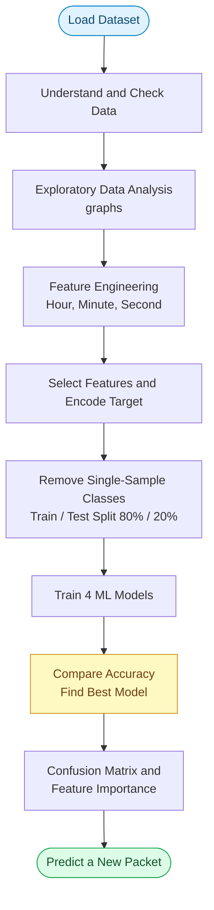

<div align="center">

# 🌐 Network Protocol Classification Using Machine Learning

### Predict the protocol of a network packet (UDP, TCP, TLS, DNS, HTTP and more) from its packet information


</div>

---

## 📊 Project at a Glance

| | |
| :-- | :-- |
| 🎯 **Goal** | Predict the protocol of a network packet |
| 🧠 **Problem type** | Multi-class classification |
| 📂 **Dataset** | Battleground (`Battleground_3.csv`), Wireshark-style capture of about 287 thousand packets |
| 🔢 **Input features** | `Length`, `Hour`, `Minute`, `Second` |
| 🏷️ **Target** | `Protocol` (18 different labels) |
| 🤖 **Models compared** | Logistic Regression, KNN, Decision Tree, Random Forest |
| 🏆 **Best model** | Random Forest, **98.60%** accuracy |
| 💻 **Platform** | Python 3 on Google Colab |

---

## 📌 Table of Contents

| # | Section | # | Section |
| :-: | :------ | :-: | :------ |
| 1 | [About the Project](#-about-the-project) | 8 | [Results and Outcomes](#-results-and-outcomes) |
| 2 | [Project Description](#-project-description) | 9 | [How to Run the Project](#%EF%B8%8F-how-to-run-the-project) |
| 3 | [Objectives](#-objectives) | 10 | [Project Structure](#-project-structure) |
| 4 | [Dataset](#-dataset) | 11 | [Limitations and Future Work](#%EF%B8%8F-limitations-and-future-work) |
| 5 | [Workflow](#-workflow) | 12 | [Conclusion](#-conclusion) |
| 6 | [Technologies and Libraries](#-technologies-and-libraries) | 13 | [Author](#-author) |
| 7 | [Machine Learning Models Used](#-machine-learning-models-used) | | |

---

## 📖 About the Project

Every time we browse a website, play an online game, or send a message, our device sends and receives small chunks of data called **packets**. Each packet follows a **protocol**, which is a set of rules for how the data is sent.

| Protocol | What it is used for |
| :------: | :------------------ |
| **TCP**  | Reliable data transfer (web pages, file downloads) |
| **UDP**  | Fast data transfer (online games, video calls) |
| **DNS**  | Converting website names into IP addresses |
| **TLSv1.2 / TLSv1.3 / SSL** | Encrypted, secure communication |
| **HTTP** | Loading web content |
| **RTCP** | Control and statistics for real-time audio and video streams |
| **WireGuard** | VPN tunnel traffic |

This project uses **Machine Learning** to look at a packet's characteristics and predict which protocol it belongs to. This is a **multi-class classification** problem.

---

## 📝 Project Description

The project uses a network traffic capture dataset called **Battleground** (`Battleground_3.csv`). The data looks like what the **Wireshark** tool records, with columns such as `No.`, `Time`, `Source`, `Destination`, `Protocol`, `Length` and `Info`. The capture holds **286,949 packets** recorded on 6 October 2022.

### 🪜 The work is done in these stages

| Step | Stage | What happens |
| :--: | :---- | :----------- |
| 1 | **Load** | Load the dataset and understand its structure (shape, data types, summary statistics) |
| 2 | **Check quality** | Check for missing values (only `Info` has 60) and duplicate rows (none found) |
| 3 | **Explore** | Explore the data with graphs: protocol distribution, packet length histogram and box plot |
| 4 | **Create features** | Convert `Time` to a datetime and extract `Hour`, `Minute` and `Second` |
| 5 | **Select features** | `Length`, `Hour`, `Minute`, `Second` are inputs; `Protocol` is the target |
| 6 | **Encode** | Convert protocol names into numbers using `LabelEncoder` |
| 7 | **Filter and split** | Drop protocols that have only 1 packet, then split 80% training and 20% testing (stratified, `random_state=42`) |
| 8 | **Scale** | Scale features with `StandardScaler` for the models that need it (Logistic Regression and KNN) |
| 9 | **Train** | Train four ML models and compare their accuracy |
| 10 | **Evaluate** | Use classification reports, confusion matrices and feature importance |
| 11 | **Predict** | Predict the protocol of a brand-new packet |

> [!NOTE]
> **Why not use Source and Destination (IP addresses) or Info?**
> IP addresses and the `Info` text have a huge number of unique values, which makes the problem too complicated for a first model. This project focuses on simple packet characteristics instead.

---

## 🎯 Objectives

- 🧭 Understand the full Machine Learning workflow, from raw data to prediction.
- 🧹 Learn data checking, visualization and feature engineering.
- ⚖️ Train and compare multiple classification algorithms.
- 📏 Evaluate a model using accuracy, a classification report and a confusion matrix.
- 🔍 Find out which packet feature matters most for identifying a protocol.
- 🧪 Build a small demo that predicts the protocol of a new packet.

---

## 📂 Dataset

| Property | Details |
| :------- | :------ |
| **Name** | Battleground (`Battleground_3.csv`) |
| **Type** | Network packet capture (Wireshark-style) |
| **Size** | 286,949 rows and 7 columns |
| **Target column** | `Protocol` |
| **Features used** | `Length`, `Hour`, `Minute`, `Second` |
| **Packet length** | Minimum 31, median 69, mean about 88, maximum 10,000 |

**Columns in the original file:** `No.` · `Time` · `Source` · `Destination` · `Protocol` · `Length` · `Info`

**Protocols found (18):** DNS, TCP, TLSv1.2, UDP, TLSv1.3, SSL, DB-LSP, HTTP, RTCP, MPEG TS, DCP-PFT, Elasticsearch, CLTP, THRIFT, R-GOOSE, DCP-AF, Pathport, WireGuard.

> The dataset is heavily dominated by **UDP**, which makes up roughly 95% of the test set. Several protocols appear only a handful of times.

---

## 🔄 Workflow



---

## 🛠 Technologies and Libraries

| Category | Tools |
| :------- | :---- |
| **Language** |  |
| **Platform** |  |
| **Data handling** |   |
| **Visualization** |   |
| **Machine learning and evaluation** |  |

---

## 🤖 Machine Learning Models Used

| # | Model | Notes |
| :-: | :---- | :---- |
| 1 | **Logistic Regression** | Simple baseline model (uses scaled data, `max_iter=1000`) |
| 2 | **K-Nearest Neighbors (KNN)** | Classifies using the 5 nearest data points (uses scaled data) |
| 3 | **Decision Tree** | Learns simple if-else rules (`max_depth=10`) |
| 4 | **Random Forest** | Many decision trees combined (`n_estimators=100`) |

---

## 📊 Results and Outcomes

### Model Comparison

| Model | Accuracy | Accuracy (%) |
| :---- | :------: | :----------: |
| Logistic Regression | 0.958738 | 95.8738% |
| KNN | 0.973968 | 97.3968% |
| Decision Tree | 0.979927 | 97.9927% |
| 🥇 **Random Forest** | **0.986025** | **98.6025%** |

### 🏆 Best Model

| | |
| :-- | :-- |
| **Model** | Random Forest |
| **Accuracy** | 0.986025 |
| **Accuracy (%)** | 98.602544 |

The Random Forest achieved the highest accuracy, about **98.60%**, on the test data (57,390 test packets, 229,558 training packets).

### 🔍 Feature Importance (Random Forest)

| Feature | Importance |
| :------ | :--------: |
| `Length` | 0.5842 |
| `Minute` | 0.2063 |
| `Second` | 0.1857 |
| `Hour` | 0.0237 |

Packet **length** is the most useful feature for telling protocols apart.

### 📋 Per-Protocol Performance (Random Forest, selected protocols)

| Protocol | Precision | Recall | F1-score | Test packets |
| :------- | :-------: | :----: | :------: | :----------: |
| UDP | 0.99 | 0.99 | 0.99 | 54,873 |
| TCP | 0.88 | 0.89 | 0.89 | 1,168 |
| DB-LSP | 0.81 | 0.85 | 0.83 | 921 |
| TLSv1.2 | 0.81 | 0.69 | 0.74 | 139 |
| DNS | 0.69 | 0.59 | 0.63 | 78 |
| SSL | 0.85 | 0.47 | 0.60 | 129 |
| TLSv1.3 | 0.56 | 0.42 | 0.48 | 24 |
| RTCP | 0.40 | 0.08 | 0.14 | 48 |

Weighted average F1 is **0.99**, but macro average F1 is only **0.35**, because very rare protocols (with 1 to 4 test packets) are not predicted correctly.

### ✨ Outcomes of the Project

- ✅ A working model that predicts a packet's protocol from its features.
- ✅ A comparison of four classification algorithms on the same data.
- ✅ Visual outputs: protocol distribution, packet length histogram and box plot, confusion matrices, decision tree plot, model comparison bar chart, and feature importance chart.
- ✅ A demo that predicts the protocol of a new packet, for example `Length = 64`, `Hour = 10`, `Minute = 30`, `Second = 15`.
- ✅ Practical understanding of data leakage prevention (the scaler is fitted only on training data).

---

## ▶️ How to Run the Project

### 🟠 Option 1: Google Colab (easiest)

**1.** Open [Google Colab](https://colab.research.google.com/) and click **New Notebook**.

**2.** Clone this repository:

```python
!git clone https://github.com/ranjan-hanra/ML-5th-Sem-Project.git
%cd ML-5th-Sem-Project
```

**3.** Install the libraries:

```python
!pip install pandas numpy matplotlib seaborn scikit-learn
```

**4.** Make sure `Battleground_3.csv` is in the working folder. If it is not, upload it:

```python
from google.colab import files

uploaded = files.upload()
```

**5.** Open `RanjanHanra(027)(1).ipynb` and run all cells in order.

### 🔵 Option 2: Run Locally

```bash
git clone https://github.com/ranjan-hanra/ML-5th-Sem-Project.git
cd ML-5th-Sem-Project
pip install pandas numpy matplotlib seaborn scikit-learn jupyter
jupyter notebook
```

Open `RanjanHanra(027)(1).ipynb` and run all cells in order. The upload cell (`from google.colab import files`) only works on Colab, so skip it locally and keep the CSV in the same folder as the notebook.

---

## 📁 Project Structure

```text
ML-5th-Sem-Project/
│
├── 📄 Battleground_3.csv              # Dataset
├── 📓 RanjanHanra(027)(1).ipynb       # Main code
└── 📝 README.md                       # Project documentation
```

---

## ⚠️ Limitations and Future Work

### Limitations

> [!WARNING]
> **High accuracy needs a closer look.** About 95% of the test packets are UDP, so a model can score high by mostly predicting UDP. Logistic Regression reaches 95.87% accuracy but has an F1-score of 0.00 for TCP, DNS, SSL and several other protocols. Always check the classification report and confusion matrix, not just accuracy.

| Limitation | Explanation |
| :--------- | :---------- |
| ⚖️ **Class imbalance** | UDP dominates, and some protocols have only 1 packet in the test set. Macro-average F1 for the Random Forest is only 0.35. |
| ✂️ **Rare classes removed** | One protocol with a single packet had to be dropped so the stratified split could run. |
| ⏱️ **Time features** | `Hour`, `Minute` and `Second` come from a capture of a limited time span. With a random split, packets from the same moment appear in both train and test sets, so these features can act as a shortcut and may not generalize to a new capture. `Minute` and `Second` together hold about 39% of the Random Forest's feature importance. |
| 🏷️ **Label encoder overwritten** | `label_encoder.classes_` is overwritten in the Random Forest report cell so it only holds the classes present in the test set. After that, the numeric labels no longer line up with the original encoding, so the "predict a new packet" step can print the wrong protocol name. The encoder should be left untouched and a separate list used for report names. |
| 🔢 **Few features** | Only four features were used, and IP addresses and `Info` were left out on purpose. |
| 🔁 **Single split** | Only one train/test split was used. Cross-validation would give a more reliable result. |

### 🚀 Future Work

- [ ] Fix the label encoder issue so the new-packet demo decodes the correct protocol.
- [ ] Split the data by time (train on earlier packets, test on later ones) to avoid time leakage.
- [ ] Add features from `Source`, `Destination` and `Info` (for example port numbers).
- [ ] Handle class imbalance (class weights, resampling).
- [ ] Report precision, recall and macro F1-score for every protocol, using `zero_division=0`.
- [ ] Tune model parameters with `GridSearchCV`.
- [ ] Try other models such as SVM or Gradient Boosting.

---

## ✅ Conclusion

This project shows how Machine Learning can be used to classify network traffic by protocol. After checking the data, creating features and comparing four models, the **Random Forest** performed best with an accuracy of **98.60%**, ahead of the Decision Tree (97.99%), KNN (97.40%) and Logistic Regression (95.87%).

The results also show why accuracy alone can mislead on imbalanced data: the model is excellent on common protocols like UDP and TCP, but struggles with rare ones. The project gave hands-on practice with the complete ML pipeline: data checking, visualization, model training, evaluation and prediction.

---

## 👤 Author

<div align="center">

**Ranjan Hanra**
Brainware University

[](https://github.com/ranjan-hanra)

⭐ *If you find this project useful, consider giving the repository a star!* ⭐

</div>