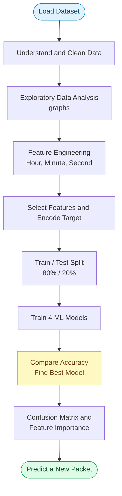

<div align="center">

# 🌐 Network Protocol Classification Using Machine Learning

### Predict the protocol of a network packet (TCP, UDP, DNS, ARP, ICMP and more) from its packet information


</div>

---

## 📊 Project at a Glance

| | |
| :-- | :-- |
| 🎯 **Goal** | Predict the protocol of a network packet |
| 🧠 **Problem type** | Multi-class classification |
| 📂 **Dataset** | KT GameBox (`KT_GameBox_1.csv`), Wireshark-style capture |
| 🔢 **Input features** | `Length`, `Hour`, `Minute`, `Second` |
| 🏷️ **Target** | `Protocol` |
| 🤖 **Models compared** | Logistic Regression, KNN, Decision Tree, Random Forest |
| 🏆 **Best model** | Decision Tree, **99.95%** accuracy |
| 💻 **Platform** | Python 3 on Google Colab |

---

## 📌 Table of Contents

| # | Section | # | Section |
| :-: | :------ | :-: | :------ |
| 1 | [About the Project](#-about-the-project) | 8 | [Results and Outcomes](#-results-and-outcomes) |
| 2 | [Project Description](#-project-description) | 9 | [How to Run the Project](#%EF%B8%8F-how-to-run-the-project) |
| 3 | [Objectives](#-objectives) | 10 | [Project Structure](#-project-structure) |
| 4 | [Dataset](#-dataset) | 11 | [Limitations and Future Work](#%EF%B8%8F-limitations-and-future-work) |
| 5 | [Workflow](#-workflow) | 12 | [Conclusion](#-conclusion) |
| 6 | [Technologies and Libraries](#-technologies-and-libraries) | 13 | [Author](#-author) |
| 7 | [Machine Learning Models Used](#-machine-learning-models-used) | | |

---

## 📖 About the Project

Every time we browse a website, play an online game, or send a message, our device sends and receives small chunks of data called **packets**. Each packet follows a **protocol**, which is a set of rules for how the data is sent.

| Protocol | What it is used for |
| :------: | :------------------ |
| **TCP**  | Reliable data transfer (web pages, file downloads) |
| **UDP**  | Fast data transfer (online games, video calls) |
| **DNS**  | Converting website names into IP addresses |
| **ARP**  | Finding the device address inside a local network |
| **ICMP** | Network error messages and ping |

This project uses **Machine Learning** to look at a packet's characteristics and predict which protocol it belongs to. This is a **multi-class classification** problem.

---

## 📝 Project Description

The project uses a network traffic capture dataset called **KT GameBox** (`KT_GameBox_1.csv`). The data looks like what the **Wireshark** tool records, with columns such as `No.`, `Time`, `Source`, `Destination`, `Protocol`, `Length` and `Info`.

### 🪜 The work is done in these stages

| Step | Stage | What happens |
| :--: | :---- | :----------- |
| 1 | **Load** | Load the dataset and understand its structure |
| 2 | **Clean** | Remove missing values and duplicate rows |
| 3 | **Explore** | Explore the data with graphs, such as the protocol distribution |
| 4 | **Create features** | Extract `Hour`, `Minute` and `Second` from the `Time` column |
| 5 | **Select features** | `Length`, `Hour`, `Minute`, `Second` are inputs; `Protocol` is the target |
| 6 | **Encode** | Convert protocol names into numbers using `LabelEncoder` |
| 7 | **Split** | 80% training and 20% testing |
| 8 | **Scale** | Scale features for the models that need it (Logistic Regression and KNN) |
| 9 | **Train** | Train four ML models and compare their accuracy |
| 10 | **Evaluate** | Use a classification report, confusion matrix and feature importance on the best model |
| 11 | **Predict** | Predict the protocol of a brand-new packet |

> [!NOTE]
> **Why not use Source and Destination (IP addresses)?**
> IP addresses have a huge number of unique values, which makes the problem too complicated for a first model. This project focuses on simple packet characteristics instead.

---

## 🎯 Objectives

- 🧭 Understand the full Machine Learning workflow, from raw data to prediction.
- 🧹 Learn data cleaning, visualization and feature engineering.
- ⚖️ Train and compare multiple classification algorithms.
- 📏 Evaluate a model using accuracy, a classification report and a confusion matrix.
- 🔍 Find out which packet feature matters most for identifying a protocol.
- 🧪 Build a small demo that predicts the protocol of a new packet.

---

## 📂 Dataset

| Property | Details |
| :------- | :------ |
| **Name** | KT GameBox (`KT_GameBox_1.csv`) |
| **Type** | Network packet capture (Wireshark-style) |
| **Target column** | `Protocol` |
| **Features used** | `Length`, `Hour`, `Minute`, `Second` |

**Columns in the original file:** `No.` · `Time` · `Source` · `Destination` · `Protocol` · `Length` · `Info`

---

## 🔄 Workflow



---

## 🛠 Technologies and Libraries

| Category | Tools |
| :------- | :---- |
| **Language** |  |
| **Platform** |  |
| **Data handling** |   |
| **Visualization** |   |
| **Machine learning and evaluation** |  |

---

## 🤖 Machine Learning Models Used

| # | Model | Notes |
| :-: | :---- | :---- |
| 1 | **Logistic Regression** | Simple baseline model (uses scaled data) |
| 2 | **K-Nearest Neighbors (KNN)** | Classifies using the 5 nearest data points (uses scaled data) |
| 3 | **Decision Tree** | Learns simple if-else rules (`max_depth=10`) |
| 4 | **Random Forest** | Many decision trees combined (`n_estimators=100`) |

---

## 📊 Results and Outcomes

### Model Comparison

| Model | Accuracy | Accuracy (%) |
| :---- | :------: | :----------: |
| Logistic Regression | 0.901188 | 90.1188% |
| KNN | 0.997256 | 99.7256% |
| 🥇 **Decision Tree** | **0.999461** | **99.9461%** |
| Random Forest | 0.999385 | 99.9385% |

### 🏆 Best Model

| | |
| :-- | :-- |
| **Model** | Decision Tree |
| **Accuracy** | 0.999461 |
| **Accuracy (%)** | 99.946124 |

The Decision Tree achieved the highest accuracy, about **99.95%**, on the test data.

### ✨ Outcomes of the Project

- ✅ A working model that predicts a packet's protocol from its features.
- ✅ A comparison of four classification algorithms on the same data.
- ✅ Visual outputs: protocol distribution, packet length histogram and box plot, model comparison bar chart, confusion matrix, and feature importance chart.
- ✅ A function-style demo that predicts the protocol of a new packet, for example `Length = 64`.
- ✅ Practical understanding of data leakage prevention (the scaler is fitted only on training data).

---

## ▶️ How to Run the Project

### 🟠 Option 1: Google Colab (easiest)

**1.** Open [Google Colab](https://colab.research.google.com/) and click **New Notebook**.

**2.** Clone this repository:

```python
!git clone https://github.com/ranjan-hanra/ML-5th-Sem-Project.git
%cd ML-5th-Sem-Project
```

**3.** Install the libraries:

```python
!pip install pandas numpy matplotlib seaborn scikit-learn
```

**4.** Make sure `KT_GameBox_1.csv` is in the working folder. If it is not, upload it:

```python
from google.colab import files

uploaded = files.upload()
```

**5.** Run the project notebook or script: `[your_notebook_or_script_name]`

### 🔵 Option 2: Run Locally

```bash
git clone https://github.com/ranjan-hanra/ML-5th-Sem-Project.git
cd ML-5th-Sem-Project
pip install pandas numpy matplotlib seaborn scikit-learn jupyter
jupyter notebook
```

Open the project notebook and run all cells in order.

---

## 📁 Project Structure

```text
ML-5th-Sem-Project/
│
├── 📄 KT_GameBox_1.csv           # Dataset
├── 📓 [project_notebook].ipynb   # Main code
└── 📝 README.md                  # Project documentation
```

---

## ⚠️ Limitations and Future Work

### Limitations

> [!WARNING]
> **Very high accuracy needs a closer look.** An accuracy near 99.95% can happen when the dataset is imbalanced (one protocol makes up most of the packets), so a model can score high by mostly predicting the common protocol. Check the classification report and confusion matrix, not just accuracy.

| Limitation | Explanation |
| :--------- | :---------- |
| ⏱️ **Time features** | `Hour`, `Minute` and `Second` are only meaningful if the `Time` column holds real clock timestamps. In Wireshark exports, `Time` is often "seconds since capture start", so these features may carry little information. |
| ✂️ **Single split** | Only one train/test split was used. Cross-validation would give a more reliable result. |
| 🔢 **Few features** | Only four features were used, and IP addresses were left out on purpose. |

### 🚀 Future Work

- [ ] Use more rows and the full dataset.
- [ ] Add features from `Source`, `Destination` and `Info`.
- [ ] Handle class imbalance (class weights, resampling).
- [ ] Report precision, recall and F1-score for every protocol.
- [ ] Tune model parameters with `GridSearchCV`.
- [ ] Try other models such as SVM or Gradient Boosting.

---

## ✅ Conclusion

This project shows how Machine Learning can be used to classify network traffic by protocol. After cleaning the data, creating features and comparing four models, the **Decision Tree** performed best with an accuracy of **99.95%**.

The project gave hands-on practice with the complete ML pipeline: data cleaning, visualization, model training, evaluation and prediction.

---

## 👤 Author

<div align="center">

**Ranjan Hanra**
Brainware University

[](https://github.com/ranjan-hanra)

⭐ *If you find this project useful, consider giving the repository a star!* ⭐

</div>
